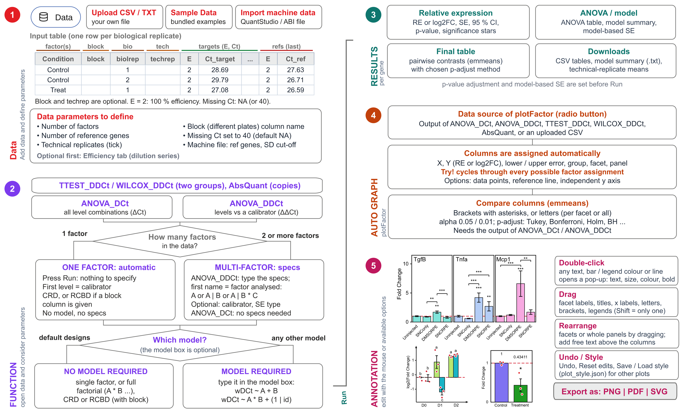
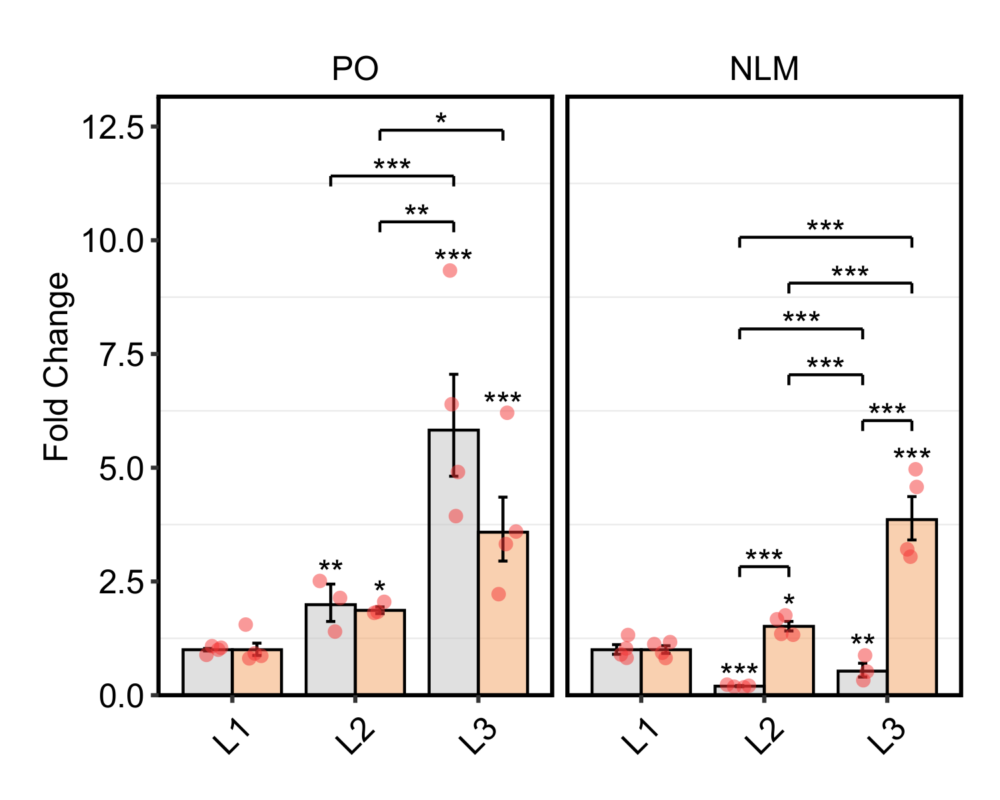
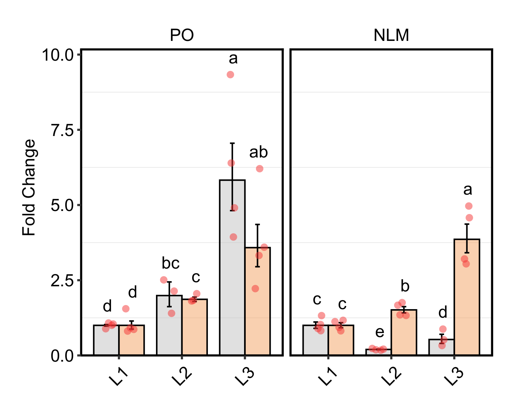
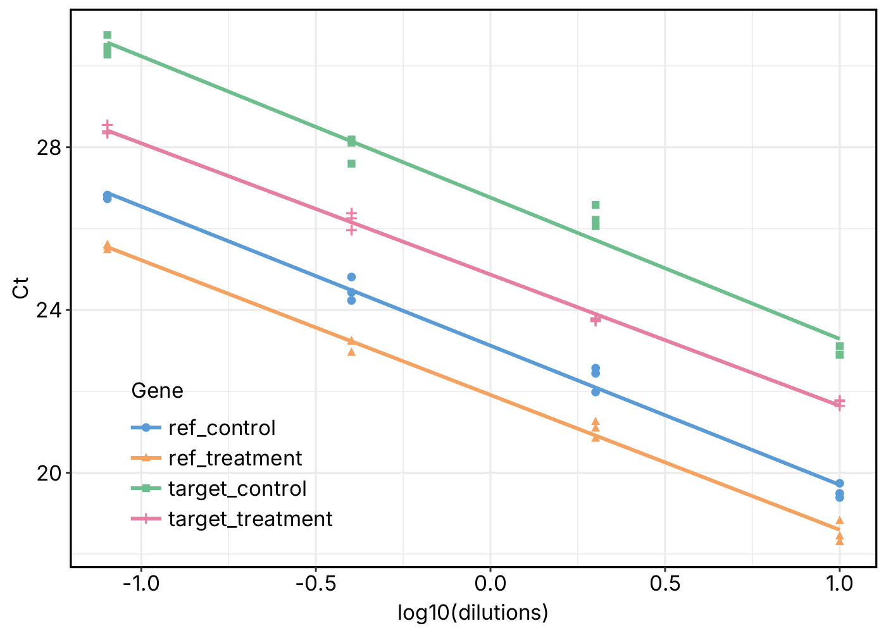
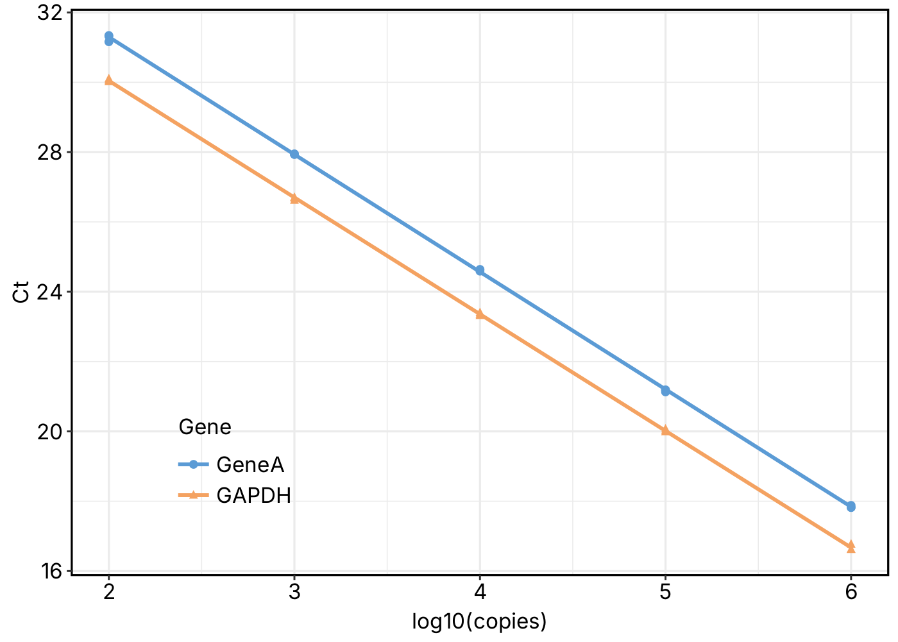

# rtpcr-java

**Efficiency-weighted qPCR analysis, from the instrument file to the publication figure, in one dependency-free Java program.**

  

rtpcr-java is a Java implementation of the R package [**rtpcr**](https://github.com/mirzaghaderi/rtpcr) 2.2.1 and of its Shiny interface ([shiny_rtpcr](https://mirzaghaderi.shinyapps.io/rtpcr)). It runs as a desktop application, as a local web application or from the command line, and needs **nothing but Java 17 or newer**: no R, no packages or server.



## Why rtpcr-java?

- **From instrument file to figure.** *ImportQPCR* turns a QuantStudio / Applied Biosystems result file into the input table (with technical-replicate QC), and the plot editor lets you finish the figure with the mouse.
- **Statistics that match the design.** Efficiency-weighted ΔCt and ΔΔCt, multiple reference genes, factorial and blocked ANOVA, random-intercept mixed models for repeated measures, t and Wilcoxon tests, standard curves and absolute quantification.
- **Private and repeatable.** mean compatisons like R emmeans, showing mean comparison results as letters, starts, or brackets, on bar plots.

## Features

| Module | What it does |
|---|---|
| **Data window** | 21 bundled example data sets; add your own CSV/TXT files; open any file in a function with its parameters pre-filled. |
| **ImportQPCR** | Machine result file → rtpcr input table. Replicate Ct-SD clean-up, merging of plates, splitting of sample names into condition / factors / replicate. |
| **Efficiency** | Standard curves from a dilution series (slope, R², E) and comparison of slopes among genes by ANCOVA. |
| **AbsQuant** | Absolute quantification: standard curves, copy numbers, optional reference-gene normalization, warnings for E, R² and range. |
| **ANOVA_DCt / ANOVA_DDCt** | Efficiency-weighted ΔCt / ΔΔCt; CRD, factorial and block designs; user-defined linear and `(1 \| id)` mixed models; `specs` for simple effects; emmeans contrasts and compact letters. |
| **TTEST_DDCt / WILCOX_DDCt** | Two-group comparisons, paired or unpaired; Student / Welch t-test; Wilcoxon test; Shapiro–Wilk test. |
| **plotFactor** | Bar plots of RE or log2FC for 1–4 factors; automatic column assignment and a **Try!** key for all layouts; data points; column comparisons; full mouse editing; export as SVG, PNG, PDF. |

## Gallery

All figures below were drawn by rtpcr-java itself (data: `data_2factorBlock3ref.csv`, `data_efficiency_Yuan2006PMCBioinf.csv`, `data_absQuant.csv`).

**ANOVA_DDCt with replicate data points** (plate as block, three reference genes, `specs = Concentration | Type`)



**ANOVA_DCt with column comparisons shown as letters**



| Efficiency (standard curves) | Absolute quantification |
|---|---|
|  |  |

## Quick start

### Option 1: run the JAR (Windows, Linux, macOS)

Requires a Java runtime, version 17 or newer.

```bash
java -jar rtpcr.jar
```

This starts the program and opens it in your browser.


### Option 2: Windows installer

Installing on windows using msi installation file (Operating System: Windows only). Download [rtpcr_2.2.0_win.msi](https://github.com/mirzaghaderi/rtpcr-java/releases). Install as a common windows installer then double-click rtpcr icon to launch the app. This is a java translated an stand alone version of the shiny_rtpcr without any dependencies.

## Input format

One row per biological replicate, in wide format: factor column(s), an optional block (plate) column, the biological replicate, an optional technical-replicate column, then an efficiency (E) and a Ct column for each target gene, with the **reference genes last**. E = 2 means 100 % efficiency.

| Type | Concentration | block | Rep | PO | Ct_PO | NLM | Ct_NLM | ref1 | Ct_ref1 | … |
|---|---|---|---|---|---|---|---|---|---|---|
| R | L1 | 1 | 1 | 1.88 | 33.30 | 1.90 | 28.77 | 1.75 | 31.53 | … |
| R | L1 | 1 | 2 | 1.88 | 33.39 | 1.90 | 28.20 | 1.75 | 31.57 | … |
| R | L1 | 2 | 3 | 1.88 | 33.34 | 1.90 | 28.48 | 1.75 | 30.50 | … |


## Typical workflow

1. **Data**: upload a CSV/TXT file, open a bundled example, or press **Import machine data**.
2. **Function and model**: choose *ANOVA_DCt*, *ANOVA_DDCt*, *TTEST_DDCt* or *WILCOX_DDCt*. With one factor nothing else is needed; with several factors type `specs` (e.g. `Concentration | Type`) and, if needed, a model such as `wDCt ~ A * B + (1 | id)`.
3. **Results**: relative expression with SE, 95 % CI, p-value and significance stars per gene; ANOVA table; model summary; CSV downloads.
4. **Plot**: *plotFactor* draws the figure automatically; double-click any element to edit it, drag labels and legends, then export SVG, PNG or PDF. Further statistical annotations are also possible.

## From the instrument file: ImportQPCR

Reads Applied Biosystems / QuantStudio exports (one row per well), uses only wells that are not omitted, converts *Undetermined* to `NA`, sets E = 2, and removes outlying technical-replicate wells until the Ct standard deviation is at or below the cut-off. It is the **Import machine data** button of the Data window.


Available functions: `ImportQPCR`, `meanTech`, `ANOVA_DCt`, `ANOVA_DDCt`, `Efficiency`, `AbsQuant`, `TTEST_DDCt`, `WILCOX_DDCt`. 
An Output example using data_2factorBlock3ref.csv file and Concentration in `specs`:

| gene | contrast | ddCt | RE | LCL | UCL | p.value | sig |
|---|---|---|---|---|---|---|---|
| PO | L2 vs L1 | -0.94610 | 1.92666 | 1.35851 | 2.73242 | 0.00116 | ** |
| PO | L3 vs L1 | -2.19198 | 4.56931 | 3.30647 | 6.31447 | 0.00000 | *** |
| NLM | L2 vs L1 | 0.86568 | 0.54879 | 0.42187 | 0.71389 | 0.00018 | *** |
| NLM | L3 vs L1 | -0.51619 | 1.43017 | 1.08699 | 1.88170 | 0.01382 | * |


## Documentation

The full reference (all ImportQPCR settings, AbsQuant, plot editing, Try! key, Data window, installer, what is ported) is in [docs/REFERENCE.md](docs/REFERENCE.md).


## License

GPL-3 (as the R package rtpcr).

## Author

Ghader Mirzaghaderi, Department of Plant Production and Genetics, University of Kurdistan, Iran. <gh.mirzaghaderi@uok.ac.ir>
